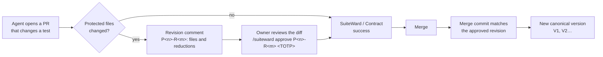

<p align="center">
  <picture>
    <source media="(prefers-color-scheme: dark)" srcset="assets/brand/svg/suiteward-logo-dark.svg">
    
  </picture>
</p>

<p align="center">
  <strong>A human-approved, tamper-evident test contract for repositories where AI agents write the code.</strong>
</p>

<p align="center">
  <a href="https://github.com/IgnisDevNE/SuiteWard/actions/workflows/ci.yml"></a>
  <a href="https://codecov.io/gh/IgnisDevNE/SuiteWard"></a>
  <a href="https://github.com/IgnisDevNE/SuiteWard/releases/latest"></a>
  <a href="LICENSE"></a>
</p>

<p align="center">
  <a href="docs/quickstart.md">Quickstart</a> ·
  <a href="docs/install.md">Install guide</a> ·
  <a href="docs/agent-install.md">Installing with an agent</a> ·
  <a href="docs/plan/README.md">Roadmap</a>
</p>

SuiteWard lets a repository hold and propose tests, but not redefine the tests that decide whether its own changes are acceptable. That set of files is a versioned, immutable contract, and only the project's verified owner can change it, by approving one exact revision with a one-time code.

## Why it exists

When an AI agent writes both the code and the tests, the same agent can edit the tests that judge its change:
- delete a failing test;
- weaken an assertion;
- skip a file;
- change the runner configuration so a test no longer runs;
- change the CI workflow.

GitHub's CODEOWNERS, branch protection and required reviews answer "who must review a change to these files". SuiteWard answers a narrower question: **is the test contract that gates this code still the one a human approved?**

## What it does

Everything happens in the pull request: comments, commands and checks, one of them required. There is no dashboard.

- **A protected scope.** A `.suiteward.yml` file lists the tests and the runner files that form the contract. `.suiteward.yml` itself and `.github/workflows/**` are always protected.
- **A proposal for every protected change.** When a pull request adds, changes or removes a protected file, or narrows the scope, SuiteWard posts a revision comment.
  - The comment lists the files added, modified and removed.
  - For a narrowed scope, it also lists the rules and paths that the narrowing drops.
- **Approval of an exact revision.** The owner approves one revision with `/suiteward approve P<n>-R<m> <code>`.
  - The code is a TOTP from the owner's authenticator app, and each code works once.
  - A new push that changes protected files makes a new revision, which needs its own approval.
  - A push that changes only implementation keeps the approval and triggers a fresh assessment.
- **A required check.** `SuiteWard / Contract` blocks the merge, through the repository's ruleset, until the current revision is approved and assessed.
- **Promotion on merge.** On merge, SuiteWard reads the merge commit's tree and compares it with the approved revision. If they match, it promotes a new canonical version (V1, V2…) in one atomic step. Versions are never rewritten, and SuiteWard checks the canonical's integrity every hour.
- **Scope discovery.** SuiteWard helps keep the scope complete. It never widens it by itself.
  - **First contract.** `/suiteward propose` suggests a declaration. The suggestion is built from file paths only, using the conventions of common frameworks (Go, pytest, Jest, Vitest, RSpec, Maven, Cargo and more) at any depth, plus runner files such as `conftest.py`, `jest.config.*` and `pytest.ini`.
  - **New tests.** A pull request that adds test-like files outside the scope gets a notice, with the updated declaration to commit.
  - **Runner files.** A pull request that adds or changes a runner file outside the scope keeps the check waiting until the owner protects or ignores it. A runner file can change how the protected tests run without touching any of them.
  - **Edit links.** Every suggested change links to GitHub's editor. When the diff shows `.suiteward.yml`, SuiteWard also posts a review suggestion that GitHub's **Commit suggestion** button applies.
  - **Mixed files.** Files that can hold test settings among other content, such as `package.json` and `pyproject.toml`, are named in a warning and never suggested.
- **Execution and the receipt (opt-in, Go).** Once the canonical `.suiteward.yml` names `execution: {profile: go}`, a separate executor runs tests in disposable sandboxes that have no network. Nothing runs before that, and turning it on is a protected change that needs the owner's approval.
  - **Canonical execution** runs the approved tests on the head of every open pull request. Under `canonical: required` it gates `SuiteWard / Contract`.
  - **The receipt** runs the tests that a revision adds or changes on the head and on the code before the change, so the owner sees whether they detect anything before approving. Under `receipt: required` it gates the approval, with a mode that only the owner names: `/suiteward approve P<n>-R<m> <fix|feature|refactor> <code>`.
  - **Where it shows.** A `SuiteWard / Receipt` check, which is never required, and a page served on loopback. A line in the revision comment links the page.
  - **The escape.** When a run cannot be completed (the executor is down, say), `/suiteward unblock <code>` lets the owner lift that run for that head. It never lifts a failing test.
  - The [install guide](docs/install.md#running-the-tests-canonical-execution-and-the-receipt) says how to turn it on and what each level does, and lists the [limits](docs/install.md#limits-of-canonical-execution).
- **Evidence, not authority.** Comments and notices explain; they never approve or protect anything. A test result is evidence about one head: it never approves anything and never enters the approval's binding. A wrong or unrecognized command gets a reply and changes nothing. The exception is a wrong or reused confirmation code, which fails the check as a security signal.
- **Labeled assurance.** An **isolated** installation, where SuiteWard, its App key, its database, the TOTP secret and the executor are out of the agent's reach, gives full assurance. A **co-located** one, next to the agent, is supported, and the check summary and the proposal, revision and merge comments say that its assurance is reduced. On that tier the executor runs as the agent's own user, so its results catch drift and accident, not a determined agent.

## A pull request, step by step



1. **The first contract.** On a repository with no contract, the owner comments `/suiteward propose`.
   - With no `.suiteward.yml`, SuiteWard replies with a suggested one and an editor link that opens with the file filled in.
   - The owner commits it and posts `/suiteward propose` again.
   - The owner approves with `/suiteward approve P1-R1 <code>` and merges, and V1 is promoted. `/suiteward skip <code>` merges a pull request without starting a contract.
2. **A change to protected files.** An agent opens a pull request that changes a test. SuiteWard posts `SuiteWard contract change P2-R1` with the changed files, and the check waits.
   - The owner reviews the diff of those files and asks the agent why they changed.
   - If the change is right, the owner approves `P2-R1`, and the check turns green.
3. **A test outside the scope.** The pull request also adds `spec/calc_spec.rb`, which the contract does not cover. SuiteWard posts a scope notice with the canonical declaration plus `*_spec.rb` and `/spec/`, ready to commit.
4. **At any time.** `/suiteward suggest` compares the pull request's head with the contract and replies with what is missing. Before the first contract, it compares with the declaration that `propose` would use.

### Commands

| Command | Who | What it does |
| --- | --- | --- |
| `/suiteward propose` | Owner | Proposes the first contract from this pull request, or replies with a suggested declaration when there is none. |
| `/suiteward skip <code>` | Owner | Lets this pull request merge before any contract exists. |
| `/suiteward approve P<n>-R<m> [fix\|feature\|refactor] <code>` | Owner | Approves that exact revision. The mode is optional, except under `receipt: required` for a receipt that is complete and not empty: an empty receipt, one that does not apply and an unblocked run that was unavailable need none ([the full rule](docs/install.md#running-the-tests-canonical-execution-and-the-receipt)). |
| `/suiteward revoke P<n>-R<m> <code>` | Owner | Withdraws an approval before the merge. |
| `/suiteward mode <fix\|feature\|refactor>` | Owner | Sets the mode that the receipt page previews. It needs no code, and no gate reads it. |
| `/suiteward unblock <code>` | Owner | Lifts the runs of this pull request's head that could not be completed, and nothing else. |
| `/suiteward suggest` | Owner | Replies with the test-like files and runner names the contract misses, and the updated declaration. It needs no code and grants nothing. |

Commands from any other account are recorded and ignored. The prefix and the verb are case-insensitive.

### The check

| State | Meaning |
| --- | --- |
| success | No protected change; or the current revision is approved and assessed. A pull request the owner skipped before the first contract is also `success`, with nothing assessed. |
| in_progress | An approval is missing, there is no contract yet, a runner file needs a decision, the revision is no longer current, the pull request comes from a fork, the tree is too large to read, SuiteWard is still reading, or, under `canonical: required`, the canonical run is pending or could not be completed. |
| failure | `.suiteward.yml` is invalid or a symbolic link hides what would be protected (`invalid-source`); the canonical failed its integrity check; a confirmation code was wrong or reused (a valid `approve` or `revoke`, or a new push, clears it); or, under `canonical: required`, an approved test fails, is missing or is flaky. |

The full table, with every reason, is in the [install guide](docs/install.md).

### `.suiteward.yml`

```yaml
version: 1
include:            # the tests
  - "**/*_test.go"
  - "**/testdata/**"
runner:             # files that change how the tests run
  - /.golangci.yml
  - scripts/ci.ps1
exclude:            # paths left out on purpose (a reduction the owner approves)
  - /docs/examples/
```

Patterns are gitignore-style. A pattern with no slash inside it matches at any depth. A symbolic link to a file of the repository is accepted unless the scope covers the link's own path; any other link that a pattern can reach makes the declaration invalid, unless an `exclude` names its exact path. Submodules are outside the scope and never read.

## What it does not do

- **It does not replace your CI's tests.** The ruleset still requires your own test check beside `SuiteWard / Contract`. Execution is opt-in and covers Go only in this phase, and its results are evidence about a head: code that behaves differently under test cannot be ruled out, and on the co-located tier a determined agent can fool the executor. The [limits](docs/install.md#limits-of-canonical-execution) are listed.
- **It does not read file contents to find tests.** A runner configured inside a mixed file (`pyproject.toml`, `package.json`) is reported, not protected.
- **It does not support pull requests from forks.** Their check stays in progress, so the ruleset blocks them (fail closed).
- **It cannot read very large monorepos** whose tree GitHub cannot list in one request.
- **It has no webhooks.** It polls GitHub about every 20 seconds, and the App needs no inbound network access.
- **It never writes to the repository.** The App reads contents and writes only checks and comments. Every commit is the owner's.

## Install

SuiteWard is self-hosted: one container image (`ghcr.io/ignisdevne/suiteward`, `linux/amd64` and `linux/arm64`) plus PostgreSQL, and a GitHub App. You install it with the `suiteward` installer, a signed release binary for linux/amd64, linux/arm64, windows/amd64, darwin/amd64 and darwin/arm64 that carries the digest of its own image. The [install guide](docs/install.md) covers both tiers:
- **Co-located:** `suiteward install` on the developer's own PC, with Podman (strongly recommended) or Docker (discouraged). It starts the stack, creates the GitHub App through your browser, writes the ruleset for you to import (and deletes the file once the protection reads as enforced), runs the owner setup, and starts the executor of canonical execution as a process of your user (a scheduled task with no window on Windows, a launch agent on macOS, a user unit on Linux). On a terminal it runs full screen, in the SuiteWard colors, with a page that explains each question, and prints plain lines with `--plain` or no terminal. Windows is validated live; macOS is covered by tests that CI runs on a macOS machine, with its live validation pending (the binaries are not notarized); Linux is covered by tests only.
- **Isolated:** `sudo suiteward install host --sha256sums <the verified SHA256SUMS of the release>`, then `suiteward install --tier isolated` as the service account (it creates the GitHub App through a Session Manager port forward, or takes one you made), on an AlmaLinux 9 host (Podman 5.5 or later) under systemd, outbound only, with full assurance. The host step also makes the executor, under an account of its own.

On Linux and macOS, one command downloads, checks and installs the binary of a release whose page lists `install.sh`:

```sh
curl -fsSL https://github.com/IgnisDevNE/SuiteWard/releases/download/<tag>/install.sh | SUITEWARD_VERSION=<tag> sh
```

Set `SUITEWARD_VERSION` to the same tag: the script is the same file in every release, and without the variable it takes GitHub's latest release, which is never a pre-release. It checks the binary against the release's `SHA256SUMS`, and verifies the signature when cosign is installed ([how it works](docs/install.md#4-get-and-verify-the-installer)). On Windows, or to verify the download by hand, use `scripts/verify-release.ps1` (same section). Verifying is optional but recommended. Check an instance at any time with `suiteward doctor`. The guide also covers TOTP enrollment, the ruleset, upgrades (`suiteward install --upgrade`, which backs up first) and key rotation. [Backup](docs/backup.md) covers backup, restore and a fresh bootstrap.

- **In a hurry?** The [quickstart](docs/quickstart.md) is the short path for each tier.
- **Installing with a coding agent?** Point it to [agent-install.md](docs/agent-install.md). It says what the agent may prepare, and which steps (the installer's GitHub flow and App key, TOTP enrollment, the ruleset, every `/suiteward` command) only you do.

## Status

- **The MVP is feature-complete for a single owner on GitHub,** and accepted on both tiers. SuiteWard governs its own tests: every pull request to this repository that changes a protected file needs the owner's approval.
- **Releases:**
  - `v0.1.0` is the first release, and `v0.1.1` adds scope discovery (M1.9).
  - `v0.1.3` was the last release before the hardening phase.
  - `v0.2.0` (2026-10-22) is the current release and runs on both tiers. It adds a least-privilege database role, `suiteward migrate`, signed releases with provenance and an SBOM, and an AlmaLinux 9 isolated host.
  - The security assessment is done, and the hardening phase ([SH](docs/plan/phases/SH.md)) is merged and released.
  - The installer (phase M1.12) shipped as the pre-releases `v0.3.0-alpha.1` and `v0.3.0-alpha.2` ([#53](https://github.com/IgnisDevNE/SuiteWard/pull/53)). Neither carries `install.sh`.
  - Phase [M1.13](docs/plan/phases/M1.13.md) is merged ([#54](https://github.com/IgnisDevNE/SuiteWard/pull/54), then the fixes [#55](https://github.com/IgnisDevNE/SuiteWard/pull/55) and [#56](https://github.com/IgnisDevNE/SuiteWard/pull/56)) and released as the pre-release `v0.4.0-alpha.1`, the first release that carries `install.sh`. It adds macOS, the one-line install, the full-screen installer, revision comments that state the numbers of the change and link a report page on loopback, and encrypted backups with a guided restore (`suiteward backup init`, `backup` and `restore`). Its live validation and its known limits are on the [phase page](docs/plan/phases/M1.13.md#outcome).
  - Phase [M1.14](docs/plan/phases/M1.14.md) is merged ([#57](https://github.com/IgnisDevNE/SuiteWard/pull/57)) and released as the pre-release `v0.4.0-alpha.2`. It refines the installer after the owner's fresh install of `v0.4.0-alpha.1`: every question explains itself on a page of its own, choices are made with the arrow keys, setup opens in a window of its own on Windows and macOS, the install ends with the result of `suiteward doctor`, `suiteward install` offers to put the program on the PATH on Windows, the default ports are 27081 and 27091, and `suiteward version` exists.
  - Phase [M1.15](docs/plan/phases/M1.15.md) is merged ([#59](https://github.com/IgnisDevNE/SuiteWard/pull/59)) and released as the pre-release `v0.4.0-alpha.3`. It closes what M1.14 left in the installer and fixes the live findings of `v0.4.0-alpha.2` on macOS and Windows: a purge never deletes another instance's token file and lists what it deletes first, no key typed before a question was drawn answers it, and GitHub's answer ends an open hidden paste. It adds `suiteward scope add`, which adds patterns to `.suiteward.yml` as text.
  - Phase [M2.1](docs/plan/phases/M2.1.md), canonical execution and the receipt with the Go profile, is in progress and is not released. Its live validation on both tiers is pending, and the executor has run on Docker only in tests.
- **Security:** see [SECURITY.md](SECURITY.md), the [threat model](docs/security/threat-model.md), and [`scripts/verify-release.ps1`](scripts/verify-release.ps1), which verifies a release's signature and provenance.
- **After the MVP:**
  - canonical execution for Python (M2.2) and TypeScript (M2.3), after the Go profile of M2.1;
  - a managed service;
  - the rest of the backup work (remote storage, scheduled backups, and a restore with a recovery mode);
  - the rest of the change report (a link to each file's diff, and a report on the check's Details page);
  - reading runner settings inside configuration files.

  The roadmap is in the [delivery plan](docs/plan/README.md).

## Architecture

- **One Go binary,** `suiteward`, serves the API and runs the workers: Go, Chi, PostgreSQL with pgx and sqlc, and River for jobs.
- **Artifacts and GitHub access:** canonical artifacts are content-addressed on a dedicated volume. GitHub is reached through a GitHub App, outbound only.
- **The executor:** `suiteward execute` is the same binary, run outside the service's container. It holds only its own token, leases jobs from the service over a bearer-token API, and runs candidate code in disposable sandboxes with no network. The service keeps the App key and the database and never gets a container-runtime socket ([ADR 0028](docs/decisions/0028-canonical-execution-and-the-receipt.md)).
- **Five invariants hold throughout:**
  - canonical immutability;
  - candidate non-authority;
  - exact-revision approval;
  - atomic promotion;
  - evidence kept distinct from authority.
- **Where to read more:** the [ADR index](docs/decisions/README.md) maps the decisions, and the [persistence](docs/contracts/persistence.md) and [runtime](docs/contracts/runtime.md) contracts fix the interfaces.

## Develop

Development targets Windows with PowerShell 7, with Windows, Linux and macOS CI and local PostgreSQL in Podman:
- `./scripts/dev.ps1 setup` prepares a checkout.
- `./scripts/dev.ps1 doctor` verifies it.
- `./scripts/dev.ps1 check` runs the checks.
- `./scripts/dev.ps1 persistence` runs the database tests.

See [local development](docs/local-development.md) and [CI and coverage](docs/ci-and-coverage.md).

Work is test-first: for governance and adapter behavior, the failing test is committed before the implementation.

An AI orchestrator plans the work, subagents implement it in isolated worktrees, and an independent reviewer checks every task. Only the owner approves protected changes and merges into `main`. The rules are in [AGENTS.md](AGENTS.md) and [orchestration](docs/plan/orchestration.md).

## License

SuiteWard is licensed under the GNU Affero General Public License v3.0 only (`AGPL-3.0-only`); see [LICENSE](LICENSE). The image carries the license texts of every third-party module linked into the binary under `/licenses`. See [ADR 0009](docs/decisions/0009-agpl-3.0-distribution.md).
